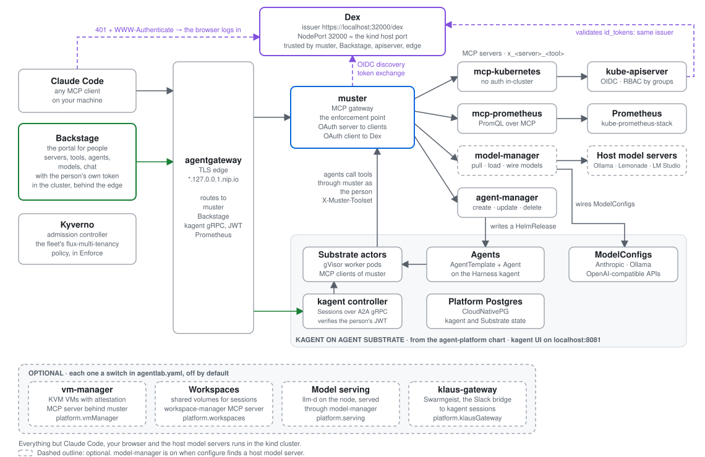

<div align="center">

# agentlab

**The Giant Swarm agent platform on your laptop.**

[](https://github.com/giantswarm/agentlab/releases)
[](https://dl.circleci.com/status-badge/redirect/gh/giantswarm/agentlab/tree/main)
[](go.mod)
[](LICENSE)

</div>

---

agentlab runs the [Giant Swarm agent
platform](https://github.com/giantswarm/agent-platform) on a
[kind](https://kind.sigs.k8s.io/) cluster on your machine. Use it to try a
change to the platform or to demo it, without a management cluster.

One command, `agentlab up`, creates the cluster and installs the platform.
It also brings its own login server ([Dex](https://dexidp.io/)) with test
users, so you can sign in right away. `agentlab down` deletes it all again.

<div align="center">
  <picture>
    <source media="(prefers-color-scheme: dark)" srcset="docs/img/architecture-dark.svg">
    
  </picture>
</div>

You and your tools reach the platform in two ways. MCP clients such as
Claude Code connect to [muster](https://github.com/giantswarm/muster), the
MCP gateway. People use the [Backstage](https://github.com/giantswarm/backstage)
portal. Either way, muster checks your login and calls the MCP servers behind
it as you. Agents run on [kagent](https://github.com/kagent-dev/kagent) and
call their tools through muster the same way.

`agentlab up` installs the same agent-platform chart that every Giant Swarm
management cluster runs. It adds the two things a management cluster gets
from elsewhere: a login server and the fleet's admission policy.

## Features

- The whole platform from one command. `agentlab up` creates a kind cluster
  and installs the agent platform. There is no YAML to edit. See
  [Getting started](docs/getting-started.md).
- Set up for your machine. agentlab finds free ports and the model servers
  running on your machine, and checks that Docker has enough CPU and memory.
- Logins that work out of the box. A built-in Dex has an admin, a developer
  and a viewer, each with their own Kubernetes rights. See
  [Identity](docs/identity.md).
- Trusted HTTPS. The lab has its own certificate authority, and
  `agentlab trust` adds it to your system in one step. See [TLS](docs/tls.md).
- The shape of a management cluster. The lab runs the same agent-platform
  chart and enforces the same admission policy as the fleet. See
  [The agent platform](docs/platform.md).
- Room for work in progress. Install an unreleased chart, a branch's dev
  build or your own build of a component. See
  [Installing an unreleased chart](docs/platform.md#installing-an-unreleased-chart).
- Proofs you can run. Each `agentlab *-test` command checks one path end to
  end, without a browser, and says why it failed. See the
  [command reference](docs/cli.md).
- Several labs side by side, each with its own ports and domain. See
  [Which lab](docs/cli.md#which-lab).
- Signed releases. `agentlab self-update` installs a new release only after
  its signature checks out. See
  [Keeping agentlab current](docs/cli.md#keeping-agentlab-current).

## Components

List of components coming with the stack:

| Component | What it does | Installed |
|---|---|---|
| [muster](https://github.com/giantswarm/muster) | MCP gateway. Checks every login and calls the MCP servers as the user | Always |
| [agentgateway](https://github.com/agentgateway/agentgateway) | TLS edge for every URL under `*.127.0.0.1.nip.io` | Always |
| [mcp-kubernetes](https://github.com/giantswarm/mcp-kubernetes) | MCP server for the lab's own cluster | Always |
| [kagent](https://github.com/kagent-dev/kagent) and [Agent Substrate](https://github.com/giantswarm/substrate) | Run the agents, each in a sandboxed pod | By default |
| [agent-manager](https://github.com/giantswarm/agent-manager) | Creates and changes agents for the portal and MCP clients | By default |
| [Backstage](https://github.com/giantswarm/backstage) | The portal for people | By default |
| [Prometheus](https://github.com/prometheus/prometheus) and [mcp-prometheus](https://github.com/giantswarm/mcp-prometheus) | The lab's metrics, queried through MCP | By default |
| [Dex](https://github.com/dexidp/dex) | Login server with three test users | Always |
| [Kyverno](https://github.com/kyverno/kyverno) | The fleet's `flux-multi-tenancy` policy, in Enforce | Always |
| [model-manager](https://github.com/giantswarm/model-manager) | Pulls and wires models on Ollama, Lemonade or LM Studio on your machine | When one is found |
| [llm-d](https://github.com/llm-d/llm-d) | Serves a model inside the cluster | `platform.serving` |
| [NFS CSI driver](https://github.com/kubernetes-csi/csi-driver-nfs) | Shared storage for agent workspaces | `platform.workspaces` |
| [vm-manager](https://github.com/giantswarm/vm-manager) | KVM virtual machines with attestation | `platform.vmManager` |
| [klaus-gateway](https://github.com/giantswarm/klaus-gateway) (Swarmgeist) | Slack bridge for agents | `platform.klausGateway` |

## Getting started

You need Docker, or Podman 4 or newer, with at least 4 CPUs and 6 GiB of
memory. Kind, Helm and the Kubernetes client are built into the binary.

First, install agentlab:

```bash
GOBIN=~/.local/bin go install github.com/giantswarm/agentlab@latest
```

You can also download a [release](https://github.com/giantswarm/agentlab/releases)
binary into `~/.local/bin`. [Verify it](docs/verify-release.md) before you
run it. `agentlab self-update` keeps it current and checks every new binary
the same way.

Then start the lab:

```bash
export ANTHROPIC_API_KEY=sk-ant-...   # optional, for the agents and the portal's AI chat
agentlab up
```

You don't need to run `agentlab configure` first. On the first run, `up`
checks your machine, asks whether to use the defaults it detected, creates
the cluster and installs the platform. At the end it offers to trust the
lab's certificate (one sudo prompt) and to open the portal. Sign in at
<https://backstage.127.0.0.1.nip.io> as `admin@lab.local`, `dev@lab.local` or
`viewer@lab.local`, password `password`. To change the lab later, run
`agentlab configure`.

Finally, connect Claude Code:

```bash
export NODE_USE_SYSTEM_CA=1   # Node 22.15 or newer
claude mcp add --transport http muster https://muster.127.0.0.1.nip.io/mcp
```

In Claude Code, run `/mcp` and sign in on the Dex page. Note that this needs
the lab's certificate to be trusted. If you said no during `up`, run
`agentlab trust`.

To check that everything works, run `agentlab platform-test`. To delete the
lab, run `agentlab down`.

[Getting started](docs/getting-started.md) has the full walkthrough,
including what `up` detects on your machine, how to connect with an older
Node and how to [run without a terminal](docs/getting-started.md#without-a-terminal).

## Documentation

| Page | What it covers |
|---|---|
| [Getting started](docs/getting-started.md) | Requirements, installing, the first `up`, connecting Claude Code |
| [Command reference](docs/cli.md) | Every command, flag and environment variable |
| [Troubleshooting](docs/troubleshooting.md) | Known problems and their fixes |
| [Verifying a release](docs/verify-release.md) | Checking a downloaded binary with cosign |
| [The agent platform](docs/platform.md) | The request path, toolsets, unreleased charts and dev builds |
| [Agents](docs/agents.md) | kagent, the default model and its API key |
| [Models](docs/models.md) | Model endpoints, models on your machine, serving with llm-d |
| [Backstage](docs/backstage.md) | The portal, its agents and models pages |
| [Identity](docs/identity.md) | Users, groups and the Dex login server |
| [GitHub sign-in](docs/github-signin.md) | Signing in to the lab with GitHub |
| [TLS](docs/tls.md) | The lab's certificate authority and how to trust it |
| [Observability](docs/observability.md) | Prometheus and mcp-prometheus |
| [Workspaces](docs/workspaces.md) | Shared storage for agent workspaces |
| [vm-manager](docs/vm-manager.md) | KVM virtual machines for agents |
| [klaus-gateway](docs/klaus-gateway.md) | The Swarmgeist Slack bridge |
| [The migration rehearsal](docs/migration-rehearsal.md) | Upgrading a 3.x lab in place to the 4.x line |
| [Usage data](docs/telemetry.md) | What agentlab reports and how to opt out |
| [Development](docs/development.md) | Building, testing and the repository layout |

## Development

```bash
CGO_ENABLED=0 go build -o agentlab .   # the lab's containers need a static binary
make test
make lint
```

The lab's end-to-end checks are its `agentlab *-test` commands, not
`go test`. [HACKS.md](HACKS.md) records every workaround and its status.
[Development](docs/development.md) has the rest.

## License

[Apache 2.0](LICENSE).
